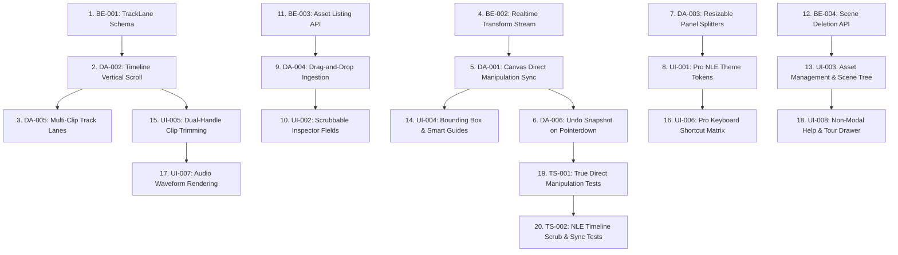

# MotionForge Remediation Backlog: Top 20 Prioritized Action Items

**Document Version:** 1.0.0  
**Date:** 2026-10-19  
**Status:** Actionable Implementation Backlog (Approved for Follow-Up Sessions)

---

## 1. Remediation Strategy & Dependency Hierarchy

To systematically eliminate all 11 user-reported issues without introducing regressions, execution must strictly follow the architectural dependency flow:
1. **Core Schema & Data Model (Backend):** Enable multi-clip track lanes and transform messaging.
2. **Timeline Viewport & Layout Architecture (Desktop/Studio):** Fix vertical scrolling and panel splitters so multi-layer scenes can be visualized and sized.
3. **Canvas Direct Manipulation & Preview Synchronization (Desktop/Studio):** Wire live transform postMessage bridge, correct bounding boxes, and fix history snapshots.
4. **Drag-and-Drop Ingestion (Desktop/Studio):** Enable seamless asset placement on canvas and timeline.
5. **UI/UX Polish & Pro NLE Tooling (Desktop/Studio):** Dark theme tokens, shortcut maps, and Kobalte component standardization.
6. **End-to-End Automated Testing (Integration):** Implement true verification tests that assert iframe DOM updates and backend persistence.



---

## 2. Top 20 Action Items

| Rank | ID | Title | Domain | Priority | Dependencies | Complexity | Solves Complaint |
| :---: | :--- | :--- | :---: | :---: | :--- | :---: | :---: |
| **1** | **BE-001** | Add `TrackLane` & `trackIndex` Support to SceneSpec | Backend | **P0** | None | M | #8 |
| **2** | **DA-002** | Add Vertical Scrolling & Virtualization to Timeline Canvas | Studio | **P0** | None | M | #5 |
| **3** | **DA-001** | Connect Canvas Direct Manipulation to Preview & Engine | Studio | **P0** | BE-002 | L | #3, #9, #10 |
| **4** | **BE-002** | Implement Ephemeral Transform `postMessage` Protocol | Runtime | **P0** | None | S | #9, #10 |
| **5** | **DA-006** | Fix Undo History to Snapshot on `pointerdown` | Studio | **P0** | None | S | #3, #10 |
| **6** | **DA-003** | Implement Drag-to-Resize Panel Splitters | Studio | **P1** | None | M | #6 |
| **7** | **DA-005** | Render Multiple Non-Overlapping Clips on Single Track Row | Studio | **P0** | BE-001, DA-002 | L | #8 |
| **8** | **DA-004** | Implement Drag-and-Drop from Vault to Canvas & Timeline | Studio | **P1** | BE-003 | M | #7 |
| **9** | **UI-004** | Extract Exact Bounding Boxes & Add Smart Alignment Guides | Studio | **P1** | DA-001 | M | #3, #9 |
| **10** | **UI-001** | Apply High-Contrast Pro NLE Dark Theme & Surface Tokens | Studio | **P1** | DA-003 | M | #1 |
| **11** | **BE-003** | Implement Missing `GET /api/assets` Endpoint | Backend | **P1** | None | S | #7 |
| **12** | **BE-004** | Implement `DELETE /api/scenes/:id` Route | Backend | **P2** | None | S | #2 |
| **13** | **UI-002** | Add Scrubbable Numeric Drag Inputs to Inspector | Studio | **P1** | None | S | #3 |
| **14** | **UI-005** | Implement Dual-Handle Clip Trimming with Cursor States | Studio | **P1** | DA-002 | M | #4 |
| **15** | **UI-003** | Separate Project Vault & Scene Hierarchy Tree | Studio | **P1** | None | S | #2 |
| **16** | **UI-006** | Implement Pro NLE Keyboard Shortcuts Map & Cheat Sheet | Studio | **P2** | None | S | #4 |
| **17** | **UI-007** | Pre-render Audio Waveforms on Timeline Tracks | Studio | **P2** | DA-002 | M | #4 |
| **18** | **UI-008** | Replace Modal Tour with Non-Intrusive Drawer | Studio | **P2** | None | S | #11 |
| **19** | **TS-001** | Add Automated Tests for Live Canvas Drag & Undo Parity | Tests | **P0** | DA-001, DA-006 | M | #3, #9 |
| **20** | **TS-002** | Add Automated Tests for Timeline Multi-Track & Vertical Scroll | Tests | **P0** | DA-002, DA-005 | M | #5, #8 |

---

## 3. Detailed Specification for Top Priority Tasks

### Item 1: BE-001 — TrackLane & trackIndex Schema Support
- **Goal:** Allow multiple clips to share a timeline track lane when their temporal intervals do not overlap.
- **Affected Files:**
  - `packages/scene-spec/src/scene-spec.ts`
  - `packages/scene-spec/src/field-guide.ts`
- **Schema Modification:**
  ```typescript
  export const layerBaseSchema = z.object({
    id: z.string().min(1),
    name: z.string().optional(),
    trackIndex: z.number().int().min(0).optional(), // 0-indexed track lane assignment
    startTimeMs: z.number().min(0),
    durationMs: z.number().positive(),
    // ...
  });
  ```
- **Acceptance Criteria:** `npm run typecheck -ws` and `npm test` pass. Existing scenes without `trackIndex` default gracefully to `trackIndex: layerIndex`.

---

### Item 2: DA-002 — Timeline Canvas Vertical Scrolling & Virtualization
- **Goal:** Enable viewing and editing arbitrarily large layer stacks without vertical clipping.
- **Affected Files:**
  - `packages/studio/src/components/Timeline.tsx`
  - `packages/studio/src/store.ts`
- **Implementation:**
  - Track `timelineScrollY` in store with mouse wheel handling on timeline canvas.
  - Render fixed top 28px Time Ruler outside the vertical scroll translation.
  - Wrap track rendering inside translated clipping rect: `ctx.translate(0, -state.timelineScrollY)`.
  - Draw synchronized track headers in the left sidebar using `tracksScrollRef.scrollTop`.
- **Acceptance Criteria:** Loading a 12-layer scene allows scrolling smoothly down to layer 12 with full click, selection, and drag interactivity.

---

### Item 3: DA-001 — Connect Canvas Direct Manipulation to Preview & Engine
- **Goal:** Real-time spatial manipulation where dragging an SVG handle transforms the video layer immediately and persists to the backend.
- **Affected Files:**
  - `packages/studio/src/components/CanvasOverlay.tsx`
  - `packages/studio/src/components/Preview.tsx`
  - `packages/scene-runtime/src/runtime.ts`
- **Implementation:**
  - Listen for pointermove events on active handles and post ephemeral transform messages to iframe.
  - Preview runtime applies GSAP transforms directly to target DOM node matrix.
  - On pointerup, invoke debounced `executeSave()` to commit new coordinates to `POST /api/scenes`.
- **Acceptance Criteria:** Dragging a text layer on canvas moves the actual rendered text in the preview monitor synchronously with 0 lag, and refreshing the page retains the new position.

---

### Item 4: BE-002 — Realtime Ephemeral Transform Stream
- **Goal:** High-performance preview message channel bypassing full scene JSON rebuilds during active dragging.
- **Affected Files:**
  - `packages/scene-runtime/src/runtime.ts`
- **Implementation:**
  - Expose `window.applyEphemeralTransform(layerId, transform)` in the runtime window.
  - Bind listener:
    ```typescript
    window.addEventListener('message', (e) => {
      if (e.data?.type === 'ephemeralTransform') {
        const { layerId, xPct, yPct, scaleX, scaleY, rotation } = e.data;
        window.applyEphemeralTransform(layerId, { xPct, yPct, scaleX, scaleY, rotation });
      }
    });
    ```
- **Acceptance Criteria:** Dragging generates smooth 60fps transform updates without triggering scene reload or audio glitching.

---

### Item 5: DA-006 — Fix Undo History Snapshot Timing
- **Goal:** Ensure `Ctrl+Z` reliably restores previous layer transforms.
- **Affected Files:**
  - `packages/studio/src/components/CanvasOverlay.tsx`
- **Implementation:**
  - Move `store.pushHistory()` from `pointerup` (line 539) to `pointerdown` (line 458).
  - Add dirty flag so an aborted click without movement does not push an identical history entry.
- **Acceptance Criteria:** Selecting a layer at (50%, 50%), dragging it to (80%, 20%), releasing, and pressing `Ctrl+Z` returns the layer exactly to (50%, 50%).

---

### Item 6: DA-003 — Drag-to-Resize Panel Splitters
- **Goal:** Provide responsive, customizable studio layout with draggable dividers between Left Dock, Monitor, Inspector, and Timeline.
- **Affected Files:**
  - `packages/studio/src/components/App.tsx`
  - `packages/studio/src/components/Splitter.tsx` (New)
  - `packages/studio/src/styles.css`
- **Acceptance Criteria:** Hovering over splitters shows resize cursors. Dragging horizontally or vertically expands target panels smoothly and saves bounds in `localStorage`.

---

### Item 7: DA-005 — Render Multiple Non-Overlapping Clips on Single Track Row
- **Goal:** Enable standard NLE timeline tracks where sequential clips share a row.
- **Affected Files:**
  - `packages/studio/src/components/Timeline.tsx`
- **Implementation:**
  - Group layers by `trackIndex`.
  - Calculate row height based on unique track indices rather than `layers.length`.
  - Enforce non-overlapping boundaries when dragging clips along the X axis.
- **Acceptance Criteria:** Two 3-second clips scheduled at 0–3s and 3–6s render seamlessly side-by-side on Track Lane 1.

---

### Item 8: DA-004 — Drag-and-Drop from Vault to Canvas & Timeline
- **Goal:** Enable dragging media files from the asset vault directly into the composition.
- **Affected Files:**
  - `packages/studio/src/components/VaultView.tsx`
  - `packages/studio/src/components/CanvasOverlay.tsx`
  - `packages/studio/src/components/Timeline.tsx`
- **Acceptance Criteria:** Dragging an image asset onto the canvas creates an image layer at the cursor position. Dragging an audio SFX onto the timeline creates an audio event at the drop timecode.
