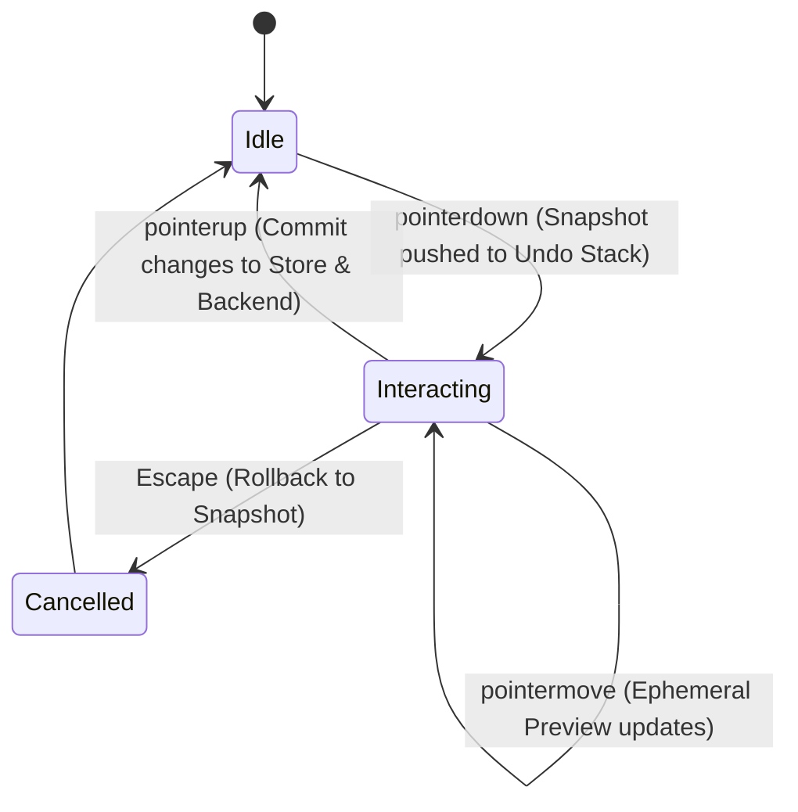

# UI/UX Remediation Plan

**Document Version:** 1.0.0  
**Date:** 2026-10-19  
**Status:** Actionable Proposal (Zero Code Changes Implemented in Audit Session)

---

## 1. Executive Summary & Design Vision

MotionForge is evolving from a prototype web studio into a **production-grade desktop motion graphics and non-linear editor (NLE)** tailored for motion graphics professionals. While previous updates implemented foundational UI components in Solid.js, empirical testing revealed severe UX shortcomings:
- Rigid, non-resizable panel grids.
- Disconnected canvas manipulation where SVG wireframes move without updating preview video layers or committing backend changes.
- Inability to scroll vertically in the timeline, cutting off layers 4+.
- Lack of track-lane hierarchy, forcing every layer onto a dedicated line.
- Missing drag-and-drop ingestion from asset vaults to canvas and timeline.
- Unclear separation of concerns between panels and disjointed state management.

This document details the complete UI/UX redesign specification, establishing an industry-standard authoring environment on par with After Effects, Premiere Pro, and DaVinci Resolve.

---

## 2. Design System Audit & Token Architecture

### 2.1 Color Palette & Dark Theme Tokens
The current theme uses basic slate colors (`#0f172a`, `#1e293b`) which lack the high-contrast elevation hierarchy needed for dense pro NLE software.

#### Target Theme Tokens (`tokens.css`):
```css
:root {
  /* Surface Elevation */
  --bg-app: #121316;             /* Desktop window root */
  --bg-surface-0: #18191d;       /* Base panel background */
  --bg-surface-1: #1f2127;       /* Card / Subpanel background */
  --bg-surface-2: #282b33;       /* Header bars, tab wells, toolbar */
  --bg-surface-3: #343842;       /* Hover states, active tabs */
  --bg-surface-active: #404552;  /* Active selection backgrounds */
  
  /* Borders & Dividers */
  --border-subtle: #242730;      /* Internal dividers */
  --border-default: #2e323e;     /* Panel boundaries & splitters */
  --border-focus: #4f87ff;       /* Focused inputs, active panel borders */
  --border-hover: #3e4454;       /* Splitter hover, card hover */

  /* Primary Accent & Brand */
  --accent-primary: #3b82f6;     /* Action buttons, playhead, primary handles */
  --accent-primary-hover: #60a5fa;
  --accent-active: #2563eb;
  --accent-muted: rgba(59, 130, 246, 0.15); /* Selected track highlight */

  /* Semantic State Colors */
  --color-success: #10b981;
  --color-warning: #f59e0b;
  --color-danger: #ef4444;
  --color-info: #06b6d4;

  /* Typography Colors */
  --text-high: #f8fafc;          /* Titles, primary values, active labels */
  --text-medium: #cbd5e1;        /* Secondary labels, inspector fields */
  --text-low: #64748b;           /* Inactive tabs, shortcuts, placeholders */
  --text-disabled: #475569;      /* Disabled actions */

  /* Timeline Layer Color Accents */
  --track-text: #ec4899;         /* Pink */
  --track-shape: #8b5cf6;        /* Purple */
  --track-image: #10b981;        /* Emerald */
  --track-lottie: #f59e0b;       /* Amber */
  --track-video: #3b82f6;        /* Blue */
  --track-audio: #06b6d4;        /* Cyan */
  --track-background: #64748b;   /* Slate */
}
```

### 2.2 Typography Hierarchy
- **UI Font Family:** `Inter, -apple-system, BlinkMacSystemFont, "Segoe UI", Roboto, sans-serif`
- **Monospace Font Family (Timecode, coordinates, frame counts, code):** `JetBrains Mono, "Fira Code", monospace`
- **Scale:**
  - `Display / Large Title`: 16px / 1.3 / Bold (Modal titles)
  - `Panel Header`: 11px / 1.2 / Semi-Bold / Uppercase / Tracking +0.05em
  - `Body / UI Default`: 12px / 1.4 / Regular
  - `Label / Secondary`: 11px / 1.3 / Regular
  - `Micro / Timecode`: 10px / 1.2 / Medium (Timeline ruler numbers, handle chips)

### 2.3 Component Primitives (Kobalte Integration)
All basic interactive primitives will strictly leverage Kobalte headless components wrapped in MotionForge design tokens:
- **Button:** Primary, Secondary, Ghost, Icon-Only, Toggle.
- **NumberField:** Scrubbable inputs where dragging horizontally on the label modifies the value with micro-increments (Shift for ×10, Alt for ×0.1).
- **Dropdown / Select:** Styled menus with keyboard navigation and checkmark states.
- **ContextMenu:** Contextual menus for timeline tracks, layers, canvas elements, and asset items.
- **Splitter / Resizable:** Draggable gutters with ghost divider preview during drag.
- **Tabs:** Flat studio tabs with subtle top border indicator when active.
- **Tooltip:** Micro-delay tooltips displaying action name and keyboard shortcut.

---

## 3. Screen Regions & Architecture

### 3.1 Current vs Target Layout Architecture

#### Current Layout (Rigid, Unresizable Grid):
```
+---------------------------------------------------------------------------------+
| Top Navigation Bar (Fixed 42px)                                                 |
+---------------------------------------------------------------------------------+
| Notification Banners / Tour Banner (Dynamic height, shifts workspace down)      |
+---------------------+-------------------------------------+---------------------+
| Left Sidebar        | Center Stage                        | Right Inspector     |
| (Fixed 280px)       | (1fr)                               | (Fixed 340px)       |
|                     | - Canvas / Iframe                   |                     |
| - Scene Tree        | - Unsynchronized SVG overlay        | - Properties        |
| - Vault Assets      | - Mini transport bar                | - Motion presets    |
| (No Splitter)       |                                     | (No Splitter)       |
+---------------------+-------------------------------------+---------------------+
| Timeline Panel (Fixed 210px) - CANNOT SCROLL VERTICALLY                         |
| - Left track list (3 layers visible max)                                        |
| - Canvas timeline (Layers rendered outside canvas clipping rect)                |
+---------------------------------------------------------------------------------+
| Status Bar (Fixed 26px)                                                         |
+---------------------------------------------------------------------------------+
```

#### Target Layout (Flexible NLE Workspace with Splitters):
```
+---------------------------------------------------------------------------------+
| Main Menu Bar & Quick Actions (Height: 36px)                                    |
| [File] [Edit] [View] [Modify] [Clip] [Sequence] [Help]  | Project Name | [Render] |
+---------------------------------------------------------------------------------+
| Workspace Toolbar (Height: 32px)                                                |
| [Tool: V/C/H/Z] | [Snapping Toggle] | [Timecode: 00:00:02:14] | [100%] [Fit]   |
+---------------------+===+-----------------------------------+===+---------------+
| Left Panel Dock     | S | Center Stage                      | S | Right Panel   |
| (Width: 240-480px)  | P | (Flexible 1fr)                    | P | Dock          |
| Tabs:               | L | - Preview Monitor (Iframe)        | L | (280-500px)   |
| [Assets] [Tree]     | I | - Direct Manipulation Overlay     | I | Tabs:         |
|                     | T | - Transform bounding box          | T | [Inspector]   |
| - Search & Filter   | T | - Smart alignment guidelines      | T | [Animation]   |
| - Drag-and-drop     | E | - Transport Controls Dock         | E | [Audio FX]    |
|   source items      | R |   (|<  <<  [Play]  >>  >|  Loop)  | R | [Diagnostics] |
+---------------------+===+-----------------------------------+===+---------------+
|============================== HORIZONTAL SPLITTER ==============================|
+---------------------------------------------------------------------------------+
| Multi-Track NLE Timeline Panel (Height: 180-600px, Default: 280px)              |
| [Track Controls]  | Time Ruler (Fixed Header, Sub-frame ticks, Marker pins)     |
| [Mute/Solo/Lock]  | Vertical + Horizontal Smooth Scroll Viewport                |
| Track Lane 1 (V1) | [Clip A (Text)] -------- [Clip B (Logo)]                    |
| Track Lane 2 (V2) | -------- [Clip C (Card Layer)] ----------------             |
| Track Lane 3 (A1) | [Audio: Whoosh.wav (Waveform Display)]                      |
+---------------------------------------------------------------------------------+
| Status Bar (Height: 22px): Engine Status, FPS, Frame: 74/150, Zoom: 100%, Git  |
+---------------------------------------------------------------------------------+
```

---

## 4. Remediation Plan for the 11 End User Complaints

### Complaint 1: Design Still Not Optimal (Unfinished & Unprofessional Layout)
- **Root Cause:** Inconsistent padding (e.g. 1px borders mixed with 12px card margins), low-contrast background grays, lack of unified button sizes, and clutter from overlapping banner alerts.
- **Specific Design Fixes:**
  1. Standardize on 4px grid rhythm (`p-1`, `p-2`, `p-3`, `p-4`).
  2. Implement dark pro-NLE theme with strict 4-level surface elevation (`--bg-surface-0` through `--bg-surface-3`).
  3. Relocate project actions into an authentic desktop App Menu bar (`File`, `Edit`, `View`, `Clip`, `Window`, `Help`) rather than scattering them in card headers.
  4. Convert floating dismissible banners (Tour, notifications) into unobtrusive non-modal status bar pills or drawer notifications that never shift the canvas viewport.

### Complaint 2: No Responsibility (Unclear Panel Ownership & Separation of Concerns)
- **Root Cause:**
  - Asset management, scene trees, and presets are intermixed in random tabs.
  - Inspector tries to show both scene-wide metadata and layer properties in a single monolithic column with chaotic accordion folding.
- **Specific Design Fixes:**
  1. **Project/Asset Dock (Left):** Owns source materials. Handles asset vault listing, asset tagging, and scene hierarchy tree. Dragging from here *creates* new layers.
  2. **Stage/Monitor (Center):** Owns spatial composition, visual verification, and direct viewport manipulation.
  3. **Timeline Dock (Bottom):** Owns temporal orchestration, keyframing, trimming, transition alignment, and audio synchronization.
  4. **Property Inspector (Right):** Owns contextual attribute modification. When a layer is clicked, it shows *only* that layer's transforms, style, and motion presets. When nothing is selected, it shows *Scene Settings* (resolution, duration, fps, background).

### Complaint 3 & 9: Control Over Elements is Poor / Preview Canvas Manipulation Buggy
- **Root Cause:**
  - `packages/studio/src/components/CanvasOverlay.tsx` computes SVG handles in local client pixels and updates an internal signal, but fails to dispatch transform updates to the preview iframe.
  - Layer coordinates on pointerup are not persisted to the backend engine.
  - Bounding boxes fall back to rough font-size estimates (`length * 0.55`) when engine frame metadata is missing.
- **Specific Design Fixes:**
  1. **Bidirectional Transform Bridge:** Implement `postMessage` protocol:
     - On drag: Overlay sends `{ type: 'ephemeralTransform', layerId, xPct, yPct, scaleX, scaleY, rotation }`.
     - Runtime immediately updates GSAP node matrix without re-rendering or re-seeking.
     - On pointerup: Overlay commits the final state via `store.updateLayer()` and debounced `api.createScene()`.
  2. **Sub-Pixel Anchor Point System:** Add a visible draggable center pivot handle (`anchorPoint: { xPct, yPct }`). Scaling and rotation occur relative to this anchor.
  3. **Smart Guides & Snapping:** Draw dynamic magenta alignment lines when dragging layer center or edges within 4px of:
     - Canvas horizontal center (`x = 50%`) and vertical center (`y = 50%`).
     - Viewport safe zones (Title safe: 90%, Action safe: 93%).
     - Bounding box edges of other visible foreground layers.
  4. **Precise Bounding Boxes:** Engine's Playwright frame inspector extracts exact DOM `getBoundingClientRect()` per layer and returns it in `framesMeta[t].layers[id].bbox`. The overlay binds directly to these true rendered bounds.

### Complaint 4: Timeline Element Control is Poor & Unreliable
- **Root Cause:**
  - Timeline clips only allow simple horizontal dragging. Trimming in/out points is twitchy due to lack of distinct handle hover states.
  - No snapping indicators or magnet mode.
  - Scrubbing triggers heavy API polling instead of smooth local frame seeking.
- **Specific Design Fixes:**
  1. **Dual-Handle Trim Zones:** Left 6px edge of a clip displays `[<` trim-in cursor; right 6px edge displays `>]` trim-out cursor. Center body displays `move` cursor.
  2. **Magnet / Snapping Engine:** When dragging or trimming, snap automatically to:
     - The current Playhead position.
     - In/Out points of adjacent clips on all tracks.
     - Scene markers.
     - Hold `Shift` to temporarily disable snapping.
  3. **Timecode Tooltip:** Display floating micro-pill during drag showing: `In: 00:01:10 (+00:00:15) | Dur: 00:02:00`.
  4. **High-Precision Scrubber:** Decouple playhead animation from frame capture. Timeline playhead moves at 60fps; sends `seekToFrame(f)` to iframe via `postMessage` directly.

### Complaint 5: Cannot See More Than ~3 Layers Stacked (No Vertical Scrolling)
- **Root Cause:** `packages/studio/src/components/Timeline.tsx` canvas rendering loop lacks `scrollY`. All track lanes rendered at Y > 146px clip into void.
- **Specific Design Fixes:**
  1. Add `timelineScrollY` state to store.
  2. In `Timeline.tsx:draw()`, preserve top 28px for fixed Time Ruler, and clip/translate the track viewport:
     ```typescript
     ctx.save();
     ctx.beginPath();
     ctx.rect(0, RULER_HEIGHT, canvasWidth, canvasHeight - RULER_HEIGHT);
     ctx.clip();
     ctx.translate(0, -timelineScrollY);
     // Render tracks, clips, and keyframe markers
     ctx.restore();
     ```
  3. Bind vertical mouse wheel (`wheelDeltaY`) to scroll the track viewport smoothly.
  4. Render an overlay custom scrollbar when total track height exceeds visible height.
  5. Synchronize scrolling with the left track header list.

### Complaint 6: No Way to Control Individual Panel Sizes (No Resizable Splitters)
- **Root Cause:** CSS grid in `styles.css:136, 377` hardcodes `280px 1fr 340px` and `42px auto 1fr 210px 26px`.
- **Specific Design Fixes:**
  1. Implement a Solid.js `Splitter` component that manages pane sizes via signals (`leftPanelWidth()`, `rightPanelWidth()`, `timelineHeight()`).
  2. Support dragging splitters with active cursor indicators (`col-resize`, `row-resize`) and blue highlight lines.
  3. Save pane sizes to `localStorage` so workspace layouts persist between sessions.
  4. Add double-click on splitter to collapse/expand panel to default width.

### Complaint 7: No Direct Drag-and-Drop for Elements
- **Root Cause:** Neither `CanvasOverlay.tsx` nor `Timeline.tsx` implements HTML5 Drag and Drop API handlers (`onDragOver`, `onDrop`).
- **Specific Design Fixes:**
  1. Make asset cards in `VaultView.tsx` draggable with `dataTransfer.setData('application/motionforge-asset', JSON.stringify(asset))`.
  2. Add `onDragOver` / `onDrop` to `CanvasOverlay.tsx`:
     - Calculate canvas coordinates from mouse event: `xPct = ((clientX - rect.left) / rect.width) * 100`.
     - Automatically create a new layer (image, lottie, video, or audio) centered at drop coordinates.
  3. Add `onDragOver` / `onDrop` to `Timeline.tsx`:
     - Determine target track lane and start timestamp from drop X/Y.
     - Insert layer with `startTimeMs = timestampFromX(dropX)` on target track.

### Complaint 8: Cannot Place More Than One Layer on the Same Timeline Row
- **Root Cause:** Current data model tightly couples `scene.layers` 1:1 with timeline visual rows.
- **Specific Design Fixes:**
  1. **Schema Track Lane Support (`TrackLane`):** Introduce an optional `trackIndex` (0..N) on layers.
  2. **Non-Overlapping Track Sharing:** Allow any two layers with non-overlapping temporal ranges (`layerA.startTimeMs + layerA.durationMs <= layerB.startTimeMs`) to share the same `trackIndex`.
  3. **Collision Detection & Auto-Lane Creation:** If layer B is dragged to overlap layer A on track 1, automatically bump layer B to track 2 or create a new track lane, exactly like Premiere and Final Cut Pro.

### Complaint 10: Real-Time Control is Broken ("Chaos and Many Errors")
- **Root Cause:**
  - Multiple components dispatch uncoordinated state mutations.
  - History undo stack pushes *post-drag* state, causing undo to corrupt positions.
  - Preview iframe reload cycle (`handleIframeLoad()`) resets zoom, playhead, and selected layer IDs unexpectedly.
- **Specific Design Fixes:**
  1. **Transactional State Machine:** All user manipulations follow a 3-phase lifecycle: `Start` (snapshot history) -> `Update` (ephemeral local preview) -> `Commit` (save & validate).
  2. **Preview Session Preservation:** The preview iframe is loaded once on scene mount. Subsequent updates pass JSON delta updates or call `window.seekToFrame(f)` without refreshing the document.
  3. **Defensive Mutation Guards:** Input fields in Inspector validate and sanitize numbers on `input` and only commit to store on `blur` or `Enter`.

### Complaint 11: General Stability, Polish & "More Issues"
- **Specific Design Fixes:**
  1. **Tour Modal Dismissal:** Replace full-screen modal tour with an unobtrusive "Help & Tips" drawer that never traps focus or hides the "Load Demo Scene" button.
  2. **Audio Waveform Visualization:** Pre-render audio peaks for SFX and music tracks directly on the timeline canvas.
  3. **Toast Management:** Consolidate error toasts into a single expandable notification bell in the status bar to prevent toast stacking from obscuring bottom controls.

---

## 5. Interaction Models & Specification

### 5.1 Selection Model
- **Single Click:**
  - Click on Canvas Layer -> Selects layer in Canvas, Timeline, and Inspector.
  - Click on Timeline Clip -> Same synchronization.
  - Click on Empty Canvas or Empty Timeline Area -> Clears selection.
- **Multi-Select:**
  - `Shift + Click` or `Cmd/Ctrl + Click` on multiple layers/clips toggles selection.
  - Multi-selection renders a combined bounding box on canvas. Dragging moves all selected layers concurrently.
- **Marquee Selection:**
  - Dragging from empty space on canvas draws a blue dashed selection marquee. Any layer intersecting the marquee is added to selection.
  - Dragging across timeline tracks selects all clips within the time range and track bounds.

### 5.2 Direct Canvas Manipulation Specification

```
         (R) Rotation Handle (16px offset)
          |
    [0]---+---[1]  Bounding Box (1px solid #3b82f6)
     |         |
    [7]   (A)  [2]  (A) = Anchor Point Pivot (Draggable)
     |         |
    [6]---+---[4]
```

- **Handles:** 8 perimeter scale handles (4 corners, 4 edge midpoints) + 1 rotation handle above top edge + 1 center anchor point.
- **Modifier Keys:**
  - `Shift` while dragging corner handle: Preserves aspect ratio.
  - `Alt / Option` while dragging handle: Scales symmetrically from anchor point.
  - `Shift` while dragging rotation handle: Snaps rotation to 15° increments (0°, 15°, 30°, 45°, 90°, etc.).
  - `Arrow Keys`: Nudges layer position by 1px (Hold `Shift` for 10px).

### 5.3 Inspector Parameter Scrubbing
- All numeric inputs (Position X/Y, Scale, Rotation, Opacity, Blur, Padding) support scrubbable labels:
  - Cursor changes to `ew-resize` on hover over the parameter label (e.g. `X:`, `Y:`, `Scale:`).
  - Dragging left decreases value; dragging right increases value.
  - Double-click on label resets parameter to its default value.

### 5.4 Undo / Redo Command History Architecture


---

## 6. Comprehensive Pro Keyboard Shortcut Map

| Category | Shortcut | Action |
| :--- | :--- | :--- |
| **Tools** | `V` | Selection Tool (Default pointer) |
| | `C` | Razor / Split Tool (Cuts clip at click or playhead) |
| | `H` | Hand Tool (Pan canvas viewport) |
| | `Z` | Zoom Tool (Click to zoom in, Alt+Click to zoom out) |
| **Playback & Transport** | `Space` | Play / Pause toggle |
| | `J` | Shuttle Reverse (1x, 2x, 4x, 8x) |
| | `K` | Pause Playback |
| | `L` | Shuttle Forward (1x, 2x, 4x, 8x) |
| | `Home` | Jump to Beginning of Sequence (Frame 0) |
| | `End` | Jump to End of Sequence |
| | `Left Arrow` | Step 1 Frame Backward |
| | `Right Arrow` | Step 1 Frame Forward |
| | `Shift + Left Arrow` | Step 10 Frames Backward |
| | `Shift + Right Arrow` | Step 10 Frames Forward |
| **Editing & Timeline** | `Ctrl/Cmd + Z` | Undo last action |
| | `Ctrl/Cmd + Shift + Z` | Redo action |
| | `Ctrl/Cmd + D` | Duplicate selected layer(s) |
| | `Delete` / `Backspace` | Delete selected layer(s) / clip(s) |
| | `Ctrl/Cmd + K` | Split selected clip at current playhead |
| | `I` | Set Work Area In Point |
| | `O` | Set Work Area Out Point |
| | `S` | Toggle Snapping (Magnet mode) on/off |
| **Zoom & View** | `Ctrl/Cmd + +` | Zoom in Timeline / Canvas |
| | `Ctrl/Cmd + -` | Zoom out Timeline / Canvas |
| | `Shift + Z` | Fit Timeline to Window / Fit Canvas to Viewport |
| | `F` | Focus selected layer on Canvas |
| **Project & Render** | `Ctrl/Cmd + S` | Force Save Scene to Backend |
| | `Ctrl/Cmd + N` | New Scene |
| | `Ctrl/Cmd + R` | Open Render Video Dialog |
| | `?` or `Ctrl/Cmd + /` | Open Keyboard Shortcuts Cheat Sheet Modal |

---

## 7. Accessibility, Contrast & Polish Checklist

- [ ] **Color Contrast:** All text tokens meet WCAG 2.1 AA requirements (Minimum 4.5:1 for body text, 3:1 for large headers and icons).
- [ ] **Focus Management:** All interactive elements feature visible focus rings (`focus-visible:ring-2 focus-visible:ring-accent-primary focus:outline-none`).
- [ ] **Keyboard Navigability:** Full tab-order support through toolbar, inspector fields, and modal dialogs.
- [ ] **High-DPI / Retina Canvas Rendering:** All HTML5 Canvas contexts (`Timeline.tsx`, Waveforms) apply `window.devicePixelRatio` scaling to eliminate blurriness on 4K/Retina displays.
- [ ] **Reduced Motion Support:** Respect `prefers-reduced-motion` media queries by disabling non-essential UI transitions while preserving canvas animation authoring.
