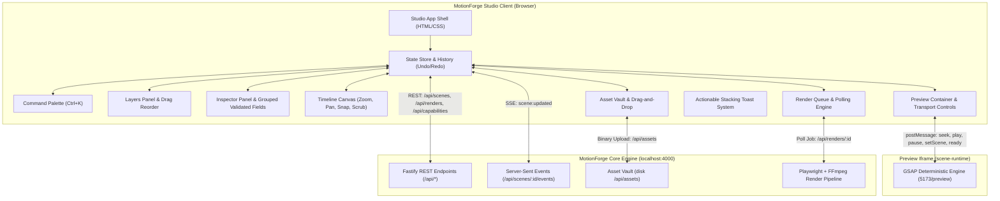

# System Architecture — MotionForge Studio

## Overview
MotionForge Studio is a browser-based, desktop-grade creative studio for creating, editing, previewing, and rendering motion graphics scenes. It interfaces with the MotionForge Core Engine via REST APIs, Server-Sent Events (SSE), and bidirectional iframe postMessage communication.

## Architecture Pattern
Modular Event-Driven Client Architecture with Centralized State & Command Dispatch (Vanilla ES Modules, DOM components, Canvas 2D rendering).

## System Diagram

## Core Components
| Component | Responsibility | Location |
|-----------|---------------|----------|
| `app.js` | App bootstrap, layout mounting, service wiring | `app.js` |
| `js/api.js` | HTTP client for Core Engine endpoints & SSE | `js/api.js` |
| `js/state.js` | Centralized state store, event emitter, undo/redo history | `js/state.js` |
| `js/panels/layers.js` | Layer list, duplicate, lock, hide, drag-reorder, search | `js/panels/layers.js` |
| `js/panels/inspector.js` | Grouped field inspector, live validation, motion presets | `js/panels/inspector.js` |
| `js/panels/timeline.js` | Multi-track Canvas 2D timeline, zoom, pan, snap, context menu | `js/panels/timeline.js` |
| `js/panels/preview.js` | Preview iframe wrapper, postMessage sync, fullscreen mode | `js/panels/preview.js` |
| `js/panels/assets.js` | Asset vault browser, drag-and-drop uploader | `js/panels/assets.js` |
| `js/panels/render-queue.js` | Render queue, multi-job tracker, background polling | `js/panels/render-queue.js` |
| `js/panels/capabilities.js`| Engine capabilities viewer and documentation | `js/panels/capabilities.js` |
| `js/ui/command-palette.js` | Fuzzy-searchable action & layer launcher (Ctrl+K) | `js/ui/command-palette.js` |
| `js/ui/toast.js` | Actionable stacked toast notifications with progress | `js/ui/toast.js` |
| `js/ui/modal.js` | Accessible dialogs with focus trapping and backdrop blur | `js/ui/modal.js` |
| `js/ui/tooltip.js` | Universal hover tooltip system | `js/ui/tooltip.js` |
| `js/ui/onboarding.js` | 5-step guided interactive walkthrough | `js/ui/onboarding.js` |
| `js/ui/shortcuts.js` | Keyboard shortcut router & reference cheat sheet | `js/ui/shortcuts.js` |
| `js/util/validate.js` | Client-side SceneSpec schema pre-validation | `js/util/validate.js` |

## Data Flow
1. User interacts with UI (drag playhead, edit field, add layer, trigger action).
2. Store dispatches action, validates mutation, pushes snapshot to Undo/Redo stack.
3. Subscribed panels re-render or selectively update modified DOM nodes / canvas.
4. Preview component throttles postMessage (`motionforge:seek`, `motionforge:play`, `motionforge:pause`) to iframe.
5. Auto-save engine debounces changes (700ms) and posts to `POST /api/scenes`.
6. Engine emits SSE `scene:updated`, preview iframe refreshes if needed, UI updates save status chip.

## External Integrations
| Service | Purpose | Auth / Protocol |
|---------|---------|-----------------|
| MotionForge Engine | Core backend REST API & asset store | HTTP localhost:4000 |
| Scene Runtime | Web preview rendering canvas | iframe postMessage + HTTP |
| Fonts CDN | Inter, JetBrains Mono, Noto Kufi Arabic | Google Fonts CDN |

## Boundaries & Invariants
- Vanilla browser execution: No compilation, transpilation, or bundlers required to run the UI
- Strict typing and schema integrity matching `SceneSpec` v1
- Color scheme strictly bounded to "Cinematic Amber" design tokens (no purple/violet remnants)
- No destructive operation without user confirmation or undo capability
- Preview sync throttled to `requestAnimationFrame`

## Security Model
- Local desktop application context
- Input validation: Client-side validation against injection and out-of-bound spec limits
- Iframe sandbox: `sandbox="allow-scripts allow-same-origin"` for local scene runtime execution
